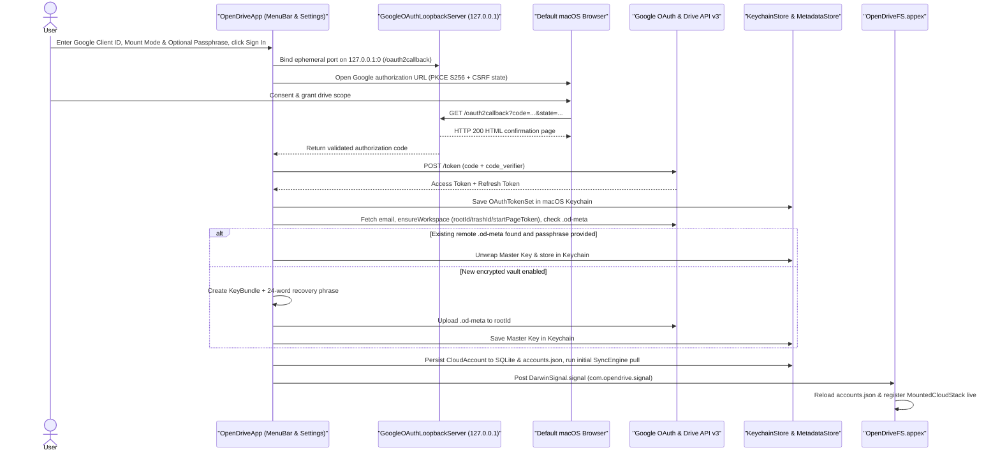
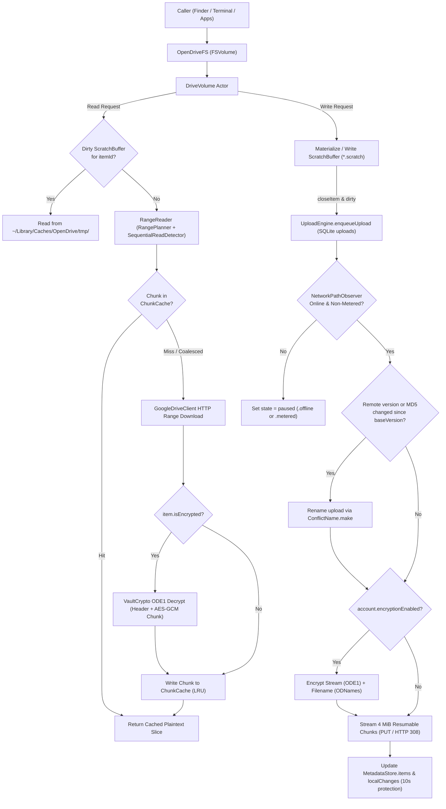

# Product Requirements Document (PRD): Open Drive for macOS

| Field | Value |
| :--- | :--- |
| **Product** | Open Drive for macOS (`org.opendrive.mac` / `org.opendrive.mac.fs`) |
| **Release Baseline** | `v1.0.0` (MIT License) |
| **Target Platform** | macOS 15.4+ (Sequoia and newer, Apple `FSKit.framework`) |
| **Last Updated** | 2026-11-21 |
| **Related Documents** | [Architecture & Data Flow](ARCHITECTURE.md) · [Security Policy](../SECURITY.md) · [Changelog](../CHANGELOG.md) |

---

## 1. Executive Summary

**Open Drive for macOS** is an open-source, native Swift user-space cloud filesystem mounter built on **Apple's `FSKit.framework`** (`FSUnaryFileSystem` / `FSVolume`). It mounts one or more Google Drive accounts directly at `~/Library/Open Drive` as a native macOS volume without kernel extensions (`kexts`), background Electron processes, or forced full-disk mirroring.

Files are streamed on demand in `4 MiB` byte ranges through an in-flight coalescing `RangeReader` and a bounded on-disk LRU `ChunkCache`. Users can optionally protect accounts with zero-knowledge client-side encryption (`ODE1` chunk encryption + `ODNames` filename encryption), queue crash-resumable background uploads with optimistic-concurrency conflict protection, and search across all mounted drives instantaneously via a Spotlight-style command palette (`⌃⌥F`).

---

## 2. Problem Statement & Market Gap

Cloud storage users on Apple Silicon and modern macOS face structural tradeoffs across existing sync and mount tools:

1. **Disk Exhaustion from Full-Sync Clients**: Traditional desktop sync clients eagerly duplicate remote storage onto local NVMe drives or struggle when selective-sync caches grow unbounded.
2. **Legacy Kernel Extensions & System Security Friction**: Classic FUSE-based cloud mounters rely on third-party kernel extensions (`kexts`) that require lowering macOS System Integrity Protection / Reduced Security policies on Apple Silicon and break across OS upgrades.
3. **Heavyweight Cross-Platform Runtimes**: Wrapper-based cloud clients consume disproportionate RAM and battery and lack native macOS `DiskArbitration`, Finder Services, and menu-bar responsiveness.
4. **Opaque Encryption & Closed Ecosystems**: Users handling sensitive documents lack auditable client-side encryption with printable recovery sheets.

**Opportunity**: Apple's native `FSKit.framework` (introduced in macOS 15.4+) enables user-space filesystem extensions (`EXExtensionPointIdentifier = com.apple.fskit.fsmodule`) with zero kernel risk. Pairing `FSKit` with a Swift 6 concurrency engine, SQLite WAL indexing, and `AES-256-GCM` chunked encryption creates a fast, auditable, open-source cloud drive for macOS.

---

## 3. Target Personas & Core Use Cases

| Persona | Primary Pain Point | Core Open Drive Workflow | Key Features Used |
| :--- | :--- | :--- | :--- |
| **Media Creators & Power Users** | Large video/audio/asset libraries exceed laptop SSD capacity. | Mount Google Drive at `~/Library/Open Drive`, scrub media on demand via byte-range streaming, and pin active project files offline. | `OpenDriveFS`, `RangeReader`, `SequentialReadDetector`, `ChunkCache` (`1–50 GiB`), Offline Pinning |
| **macOS Developers & CLI Users** | Need standard POSIX paths (`cat`, `rg`, `git`, build scripts) without kexts. | Access cloud files directly via shell or scripts under `~/Library/Open Drive/<Account>`, trigger manual delta refreshes via `.od-refresh`. | `FSUnaryFileSystem`, `DriveVolume`, `.od-refresh`, case-insensitive `shownAs`/`folded` |
| **Privacy-First Individuals** | Do not trust cloud providers with unencrypted documents or filenames. | Enable Zero-Knowledge Vault (`ODE1` + `ODNames`), store wrapped `KeyBundle` remotely in `.od-meta`, and save printable 24-word PDF recovery key. | `VaultCrypto`, `.od-meta`, `KeychainStore`, `RecoveryKeyPDF`, Vault Unlock UI |

---

## 4. Product Goals, Non-Goals & Success Metrics

### 4.1 Goals
- **Kext-Free Native Mounting**: Mount and browse Google Drive accounts inside Finder and Terminal at `~/Library/Open Drive` exclusively via `FSKit`.
- **Bounded Storage Footprint**: Keep local cache strictly capped within the user-configured LRU budget (`1–50 GiB`, default `5 GiB`) while exempting explicitly pinned items.
- **Zero Data Loss on Edits or Eject**: Stage local writes atomically in `ScratchBuffer`, detect remote version/hash drift before overwriting (`ConflictName`), and veto premature unmount via `DiskArbitration` while uploads are in flight.
- **Zero-Knowledge Option**: Encrypt file payloads (`ODE1`) and filenames (`ODNames`) client-side so Google Drive servers never observe plaintext bytes or names.

### 4.2 Explicit Non-Goals (v1.x)
- Supporting macOS releases prior to **macOS 15.4** or shipping kernel extensions (`kext` / `macFUSE`).
- Acting as a full offline-first bi-directional folder mirror.
- Running hosted Open Drive telemetry servers, OAuth proxy relays, or proprietary cloud backends.
- Real-time collaborative co-editing of proprietary Google Docs/Sheets/Slides formats inside macOS native editors.

### 4.3 Success Metrics (KPIs)

| Metric | Target | Verification Method |
| :--- | :--- | :--- |
| **Cold Volume Activation** | `< 2.0 s` from `mount -t opendrive` to root listing | Manual / `FSKit` integration benchmark |
| **Local Palette Search Latency (`⌃⌥F`)** | `< 50 ms` across locally indexed `items` in SQLite | `MetadataStore.searchItems` timing on indexed DB |
| **Cache Cap Adherence** | `totalBytes <= maxBytes` after `ChunkCache.put` eviction pass | `ChunkCache` eviction logic & unit verification |
| **Concurrent Read Deduplication** | Single remote HTTP `Range` fetch per `(driveId, version, chunkIndex)` under concurrent reads | `RangeReaderTests.testRangeReaderCoalescingAndSequentialDetection` |
| **Race & Conflict Safety** | `0` silent overwrites on concurrent remote edits; `0` premature unmounts with active uploads | `UploadEngine` `baseVersion`/`baseHash` checks + `SyncEngineTests` + `DiskArbitration` callback |
| **Automated CI Pass Rate** | `100%` pass on `swift build`, `swift test`, and `Scripts/bundle-app.sh` | GitHub Actions (`macos-15`) |

---

## 5. Core User Journeys & System Flows

### 5.1 Interactive OAuth 2.0 PKCE & Vault Bootstrap Flow

### 5.2 On-Demand Read & Staged Write Lifecycle

---

## 6. Functional Requirements

### FR-1: Native Apple `FSKit` Filesystem Mounting (`OpenDriveFS.appex`)
**Priority**: `P0` · **Status**: Shipped in `v1.0.0`

**Specification**:
- Implement `UnaryFileSystemExtension` (`OpenDriveFSAppExtension`), `FSUnaryFileSystem` / `FSUnaryFileSystemOperations` (`OpenDriveFileSystem`), and `FSVolume` (`OpenDriveVolume`) conforming to `Operations`, `PathConfOperations`, `OpenCloseOperations`, `ReadWriteOperations`, `XattrOperations`, and `AccessCheckOperations`.
- Expose a virtual root directory (`rootItemId = 2`) containing one top-level folder per configured `CloudAccount` (`displayName`), plus remote files and folders identified by persistent `UInt64` inodes (`nextInodeNumber` starting at `100`).
- Support lookup for `.od-refresh` inside any mounted directory to asynchronously trigger an immediate `SyncEngine.pullRemoteChanges` pass across registered accounts.
- Report case-insensitive, case-preserving capabilities (`caseFormat = .insensitiveCasePreserving`), 64-bit object IDs, hidden file support, `maximumNameLength = 255`, `maximumXattrSize = 64 KiB`, `maximumFileSize = Int64.max`, and virtual capacity statistics (`1 TiB` nominal pool in `v1.0.0`).
- Listen on Darwin notifications for `com.opendrive.signal` (reload `accounts.json` and sync), `com.opendrive.cancelUpload`, and `com.opendrive.clearCache`.

**Acceptance Criteria**:
- Mounting via `/sbin/mount -t opendrive opendrive "~/Library/Open Drive"` succeeds when `OpenDriveFS.appex` is registered and signed with FSKit entitlements.
- Adding or removing an account in `OpenDriveApp` triggers `DarwinSignal.signal`, and `OpenDriveVolume` dynamically updates top-level account folders without unmounting.
- Colliding case-insensitive sibling filenames (e.g., `Report.pdf` and `report.PDF`) render deterministically using `shownAs` disambiguation (`report (<6-char-id>).PDF`).

---

### FR-2: Google Drive Authentication & Workspace Modes
**Priority**: `P0` · **Status**: Shipped in `v1.0.0`

**Specification**:
- Authenticate desktop users using OAuth 2.0 Authorization Code flow with PKCE (`S256` challenge, 32-byte random verifier) and CSRF `state` validation (`GoogleOAuth`).
- Bind an ephemeral HTTP listener on `127.0.0.1:0/oauth2callback` (`GoogleOAuthLoopbackServer`) that accepts the browser redirect, validates `state`, extracts `code`, returns an HTML status page, and closes cleanly.
- Exchange the authorization code for an `OAuthTokenSet` (supporting optional desktop `clientSecret`), persist it in macOS Keychain (`KeychainStore`, service `com.opendrive.shared`), and automatically refresh access tokens within `60 s` of expiration while preserving existing refresh tokens when not rotated.
- Support two workspace roots via `GoogleDriveClient.ensureWorkspace(wholeDrive:)`:
  - **Dedicated Folder Mode (`wholeDrive = false`)**: Creates/reuses tagged folders `Open Drive` (`appProperties.odRoot = "1"`) and `Open Drive Trash` (`appProperties.odTrash = "1"`).
  - **Whole Drive Mode (`wholeDrive = true`)**: Mounts the user's entire Google Drive `"root"`.

**Acceptance Criteria**:
- OAuth callbacks with mismatched `state` or `error` query parameters are rejected with `GoogleDriveError.oauthFailed`.
- Valid callbacks receive `HTTP 200 OK` and exchange into persisted Keychain tokens.
- Expired tokens trigger transparent refresh before API requests execute.

---

### FR-3: On-Demand Streaming Reads & Bounded LRU Cache
**Priority**: `P0` · **Status**: Shipped in `v1.0.0`

**Specification**:
- Decompose arbitrary POSIX `(offset, length)` reads into aligned `4 MiB` (`OpenDrivePaths.defaultChunkSize`) `ChunkSlicePlan` slices clamped to logical file size (`RangePlanner`).
- Coalesce concurrent requests targeting the same `ChunkKey(driveId, contentVersion, index)` inside `RangeReader.inFlight` so only one network fetch executes per chunk.
- Detect sequential reads (`SequentialReadDetector`, `streakThreshold = 2`, `lookaheadCount = 2`) and schedule background lookahead chunk fetches.
- Persist plaintext chunks atomically in `~/Library/Caches/OpenDrive/chunks` (`ChunkCache`) with LRU eviction bounded by `maxBytes` (default `5 GiB`, floor `64 MiB`), exempting items marked `pinned = true`, and supporting full cache clearing on `com.opendrive.clearCache`.

**Acceptance Criteria**:
- Two concurrent reads over overlapping byte ranges trigger at most one remote `downloadByteRange` call per chunk.
- Reading a chunk sequentially across chunk boundaries triggers lookahead caching of subsequent chunks.
- Adding chunks beyond `maxBytes` evicts the least-recently-accessed unpinned chunks first while preserving pinned chunks.

---

### FR-4: Local Write Staging, Resumable Uploads & Conflict Safety
**Priority**: `P0` · **Status**: Shipped in `v1.0.0`

**Specification**:
- Stage file writes locally in `~/Library/Caches/OpenDrive/tmp/<uuid>.scratch` (`ScratchBuffer`) so reads before close reflect uncommitted local bytes.
- Upon `closeItem`, enqueue a durable `UploadRecord` (`queued`) in `MetadataStore.uploads` recording `baseVersion`, `baseHash`, `parentId`, `targetDriveId`, and `encrypt`, then drain the queue through `UploadEngine`.
- Perform optimistic concurrency validation prior to upload: if `targetDriveId` exists remotely and either `version != baseVersion` or `md5 != baseHash`, rewrite the upload target as a new file named via `ConflictName.make(for:)` (`"<stem> (conflict from yyyy-MM-dd HH.mm).<ext>"`) and set `renamedLate = true`.
- Stream uploads in `4 MiB` (`uploadQuantumSize`, multiple of `256 KiB`) chunks to Google Drive's resumable upload session URL (`HTTP PUT` / `308 Resume Incomplete`), persisting offset progress after each chunk.
- Enforce configured `BandwidthMode` throttling (`.off`, `.auto`, `.fixed(mbps)`), check `cancelRequested` before each chunk, retry failures with exponential backoff capped at `300 s`, and auto-pause uploads (`.metered` or `.offline`) via `NetworkPathObserver` (`NWPathMonitor`) whenever the active network path is expensive, constrained, or unsatisfied—resuming automatically when unmetered connectivity returns.

**Acceptance Criteria**:
- Creating, writing, and closing a file inside `DriveVolume` uploads it to the provider and transitions the VFS node from `.scratch` to `.remote` seamlessly.
- Remote version/MD5 divergence produces a timestamped conflict copy without overwriting remote data.
- Offline or hotspot (`isExpensive || isConstrained`) transitions move queued uploads to `.paused`, and Wi-Fi/Ethernet restoration triggers `processQueue`.

---

### FR-5: Local Metadata Indexing & Continuous Delta Sync
**Priority**: `P0` · **Status**: Shipped in `v1.0.0`

**Specification**:
- Store per-account state at `~/Library/Application Support/OpenDrive/db/<accountId>.sqlite` in SQLite3 WAL mode (`FULLMUTEX`, `5,000 ms` busy timeout) across six tables: `account`, `items` (indexed on `(parentId, folded)`), `uploads`, `staleNames`, `localChanges`, and `recentFolders`.
- Hydrate the root directory automatically on first sync (`SyncEngine.pullRemoteChanges`) and hydrate nested folders on demand when opened in Finder or CLI (`hydrateFolderIfNeeded`), filtering out `.od-meta` and the dedicated trash folder.
- Run a configurable background sync loop (`DriveVolume.startBackgroundSyncLoop(intervalSeconds: 30.0)`) polling `changes.list` via `changesPageToken`, invalidating cached chunks in `ChunkCache` whenever `contentVersionToken` changes, and posting `DarwinSignal.pulled` (`com.opendrive.pulled`) when updates apply.
- Record `localChanges` on upload commit and skip incoming remote delta events matching a `driveId` modified locally within the trailing `10 s` (`wasRecentlyModifiedLocally`).

**Acceptance Criteria**:
- Opening an uncached subfolder in Whole Drive mode hydrates its children from Google Drive once and caches them in SQLite.
- A remote deletion event arriving within 10 seconds of a local write commit is ignored so newly written items do not vanish before Google Drive's feed settles.

---

### FR-6: Zero-Knowledge Client-Side Encryption Vault (`VaultCrypto`)
**Priority**: `P1` · **Status**: Shipped in `v1.0.0`

**Specification**:
- Provide optional client-side encryption using a 256-bit random Master Key (`MK`) wrapped inside a JSON `KeyBundle` (`.od-meta`):
  - **Passphrase Wrap (`mkByPass`)**: `PBKDF2-HMAC-SHA256` (`210,000` iterations, 16-byte random salt) deriving a KEK to seal `MK` with `AES-256-GCM`.
  - **Recovery Phrase Wrap (`mkByRecovery`)**: 24-word recovery phrase processed via `HKDF-SHA256` (salt `"OpenDrive-BIP39-Recovery-v1"`, info `"mkByRecovery"`) to seal a second copy of `MK`.
  - **Sharing Keypair Fields**: Generates and stores Curve25519 key agreement material (`reqPub`, `reqPrivByMK`) for future encrypted sharing workflows.
- Encrypt file streams using the `ODE1` binary format:
  - 72-byte header: `"ODE1"` (`4 B`) + random `noncePrefix` (`8 B`) + `AES.GCM.seal(fileKey, using: MK).combined` (`60 B`).
  - Independent `4 MiB + 16 B` encrypted chunks for index `i = 0, 1, ...`, each sealed with `fileKey` and deterministic 12-byte nonce `noncePrefix (8 B) || UInt32(i).bigEndian (4 B)`.
- Encrypt filenames using `ODNames`: `HKDF-SHA256` subkey (`info = "ODNames-v1"`) + `AES-256-GCM` + unpadded `Base64URL`, tagged on Drive via `appProperties["odEnc"] = "1"` (and `"odName"` on folders), while computing logical plaintext size from wire size when listing remote encrypted files.
- Synchronize `.od-meta` with the Google Drive root (`fetchKeyBundle` / `uploadKeyBundle`), unlock vaults by passphrase or 24-word phrase, and generate a US-Letter (`612 × 792 pt`) PDF recovery sheet (`open drive recovery key.pdf`) via CoreGraphics/CoreText.

**Acceptance Criteria**:
- Random-access decryption of chunk `i` succeeds directly from wire byte range `[72 + i*(chunkSize+16) ..< ...]` without fetching or decrypting prior chunks.
- Wrong passphrases fail with `VaultCryptoError.authenticationFailed`.
- Generated recovery key PDF starts with `%PDF-` and includes all 24 numbered recovery words.

---

### FR-7: macOS Menu-Bar App, Power-User Accelerators & Eject Guard (`OpenDriveApp`)
**Priority**: `P1`/`P2` · **Status**: Shipped in `v1.0.0`

**Specification**:
- **Menu-Bar Popover (`MenuBarRootView`)**: `LSUIElement` menu-bar extra showing Mount/Unmount control, `OFFLINE` / `HOTSPOT` network badges, status banner, inline search bar, drag-and-drop upload dropzone (`onDrop(of: [.fileURL])`) with `recentFolders` destination picker, live upload queue (top 3 items + per-item Cancel), connected accounts list with lock/unlock indicators, and quick actions (*Open in Finder*, *Refresh Sync*, *Clear Cache*, *Quit*).
- **3-Tab Settings Window (`SettingsView`)**:
  - **General**: Mount/unmount button, Launch at Login (`SMAppService.mainApp`), toggle `⌃⌥F` shortcut, Local Disk Cache slider (`1–50 GiB`), and *Purge Cached Chunks Now*.
  - **Accounts & Vault**: Google OAuth Client ID and optional Client Secret, account display name, Whole Drive toggle, Zero-Knowledge Encryption toggle + passphrase, *Sign in with Google (Browser PKCE)*, offline/local account creation, 24-word phrase display + *Export Recovery Key PDF...*, and configured account removal / vault unlock.
  - **Network**: Toggle *Pause Uploads on Personal Hotspot / Metered Network* and Upload Bandwidth Cap slider (`0–200 Mbps`).
- **Global Search Palette (`⌃⌥F`)**: `PalettePanelController` listens globally and locally for `Control + Option + F` to toggle a floating non-activating `NSPanel` (`GlobalPaletteView`) offering cross-account search, Offline Pin/Unpin, *Reveal* in Finder, and *Open*.
- **Floating HUD Pill**: `HUDPillWindowController` displays a translucent capsule HUD (`HUDPillView`) at top-right whenever uploads are pending or an eject-guard warning is triggered, with one-click cancel.
- **DiskArbitration Eject Guard & Safe Quit**: `MountManager` registers `DARegisterDiskUnmountApprovalCallback`; if `MountManager.hasActiveUploadsSync()` returns `true` for `~/Library/Open Drive`, unmount is vetoed with `kDAReturnBusy` (`DADissenter`) and `DarwinSignal.ejectGuard` surfaces the HUD warning. On app termination, the volume unmounts cleanly only when no uploads are pending.
- **Finder Services (`NSServices`)**: Declares `"Upload to Open Drive"` (`uploadToOpenDrive`, `⌘⇧C`, `public.item`) in `Config/OpenDriveApp-Info.plist` handled by `FinderServiceProvider`.

**Acceptance Criteria**:
- Selecting files in Finder and invoking *Upload to Open Drive* (`⌘⇧C`) or dropping files into the menu-bar dropzone stages files into `scratchCacheURL` and enqueues uploads immediately.
- Attempting to eject `~/Library/Open Drive` while SQLite `uploads` contains pending records returns `kDAReturnBusy` and notifies the user.

---

## 7. Non-Functional Requirements

| Category | Requirement |
| :--- | :--- |
| **Performance** | `ChunkCache` serves repeated/prefetched reads locally without HTTP calls; `RangeReader` coalesces concurrent chunk fetches; SQLite `items_parent_folded` index ensures instant directory lookup and command palette search. |
| **Concurrency & Safety** | Core storage (`MetadataStore`), cache (`ChunkCache`, `RangeReader`), sync (`SyncEngine`, `UploadEngine`), and VFS (`DriveVolume`) are isolated as Swift `actor`s; UI state runs strictly on `@MainActor`. SQLite runs in WAL mode with `FULLMUTEX` and a `5,000 ms` busy timeout. |
| **Security & Privacy** | Zero third-party analytics or crash telemetry. OAuth tokens and unwrapped vault Master Keys reside in macOS Keychain (`kSecAttrAccessibleAfterFirstUnlock`). Data encryption uses `AES-256-GCM` authenticated encryption (`VaultCrypto.tampered` / `authenticationFailed` protection). |
| **Platform & Toolchain** | Requires macOS 15.4+, Apple Silicon or Intel Mac with `FSKit.framework`, and Xcode 16.3+ / Swift 6 toolchain (`swiftLanguageModes: [.v5]` in `Package.swift` for Objective-C `FSKit` bridging). |
| **Distribution & CI** | Deterministic CLI packaging via `Makefile`, `Scripts/bundle-app.sh` (ad-hoc or Developer ID signing + `pluginkit -a`), `Scripts/create-dmg.sh` (`hdiutil create`), and `.github/workflows/ci.yml` (`macos-15`). |

---

## 8. Release Roadmap & Milestone Plan

### Milestone 1: `v1.0.0` — Core Foundation & Feature Complete *(Shipped 2026-11-14)*
All core modules implemented across 3 SwiftPM targets, documented, bundled cleanly into `dist/Open Drive.app` (`OpenDriveFS.appex`), and verified with 7 passing XCTest suites:
- `DriveVolumeTests` (scratch write, commit, list, and read-back lifecycle)
- `GoogleOAuthTests` (PKCE S256 generation, CSRF state validation, loopback HTTP callback parsing)
- `MetadataStoreTests` (account persistence, case-insensitive sibling collision disambiguation, palette search)
- `RangeReaderTests` (cross-chunk reads and disk cache coalescing)
- `RecoveryKeyPDFTests` (24-word phrase generation and `%PDF-` recovery sheet export)
- `SyncEngineTests` (initial hydration, on-demand subfolder hydration, 10s `localChanges` protection)
- `VaultCryptoTests` (`KeyBundle` wrap/unlock, `ODNames`, `ODE1` full & random-access chunk decryption)

### Milestone 2: `v1.1` — Production Hardening & Signed Distribution *(Planned Next)*
Tracked enhancements derived directly from architectural review of the `v1.0.0` codebase:
1. **Shared App Group Preferences (`group.org.opendrive.mac`)**: Migrate `googleClientId`, `googleClientSecret`, `maxCacheGiB`, `pauseOnMetered`, and `bandwidthLimitMbps` from `UserDefaults.standard` to `UserDefaults(suiteName: "group.org.opendrive.mac")` so settings modified in `OpenDriveApp` propagate reliably to `OpenDriveFS.appex` on `DarwinSignal.signal`.
2. **Explicit Keychain Access Group**: Wire `kSecAttrAccessGroup` (`org.opendrive.mac.shared`) into `KeychainStore` when built with a Developer ID / App Group provisioning profile so signed app and extension processes share credentials seamlessly under macOS entitlements.
3. **Apple Entitlement Approval & Notarized Release Pipeline**: Obtain Developer ID Application & Apple `com.apple.developer.fskit.fsmodule` entitlements, and add `xcrun notarytool submit` + stapling to `Scripts/create-dmg.sh`.
4. **Standard 2,048-Word BIP-39 Dictionary**: Expand `VaultCrypto.wordList` from its 256-word `v1.0.0` seed list to the full 2,048-word BIP-39 standard list with checksum verification (retaining backward compatibility with `v1.0.0` `.od-meta` vaults).
5. **Partial File Edits & `ftruncate` Support**: Hydrate remote files on non-zero write offsets and handle `setAttributes` size truncation in `OpenDriveVolume` and `DriveVolume`.
6. **Cache Index Persistence & Quota Reporting**: Reconcile existing chunk files on disk at `ChunkCache` startup so `totalBytes` stays accurate across extension restarts, and query Google Drive `about(fields: "storageQuota")` to populate live `FSStatFSResult` capacity metrics.
7. **Google Workspace Document Handling**: Represent native Google Docs/Sheets/Slides gracefully (either as `.webloc` browser links or export-on-read office/PDF artifacts) rather than `0`-byte binary stubs.
8. **Version Alignment & Expanded Tests**: Bump `CFBundleShortVersionString` in `Config/OpenDriveApp-Info.plist` and `Config/OpenDriveFS-Info.plist` from `0.1.0` to match release tags, and add dedicated unit tests for `UploadEngine` conflict/throttle/cancel transitions.

### Milestone 3: `v2.0` — Multi-Cloud & Encrypted Collaboration *(Future)*
1. **Additional Storage Backends**: Implement new `CloudDrive` providers (OneDrive, Dropbox, S3-compatible / Cloudflare R2, WebDAV).
2. **Encrypted Folder Sharing**: Utilize existing X25519 key fields (`KeyBundle.reqPub`, `reqPrivByMK`) for peer-to-peer shared encrypted folders.
3. **macOS System Polish**: Persistent SQLite-backed extended attributes (`xattrs`), QuickLook thumbnail generator for encrypted remote files, and Sparkle in-app updates.

---

## 9. Risks, Constraints & Mitigations

| Risk / Constraint | Severity | Impact | Mitigation |
| :--- | :--- | :--- | :--- |
| **Apple FSKit Entitlement Gate** | High | `com.apple.developer.fskit.fsmodule` requires Apple Developer approval for Developer ID / Mac App Store distribution. | Ad-hoc signing works locally for development/testing; apply early for FSKit distribution entitlement for `v1.1` binary releases. |
| **Unverified Google OAuth Consent Screen** | Medium | Self-hosted desktop users creating their own OAuth Client ID see Google's "Unverified App" warning while in Testing mode (7-day refresh token expiry unless published or using verified app). | Document Test User vs. In-House app setup in [README.md](../README.md); evaluate verified community OAuth app flow for `v1.1`. |
| **Google Drive API Rate Limits (`403` / `429`)** | Medium | Concurrent chunk reads/uploads or large directories may hit per-user Drive API quotas. | `RangeReader` deduplicates in-flight chunks, `SequentialReadDetector` bounds lookahead, and `UploadEngine` uses exponential backoff up to `300 s`. |
| **Cross-Process Preferences Drift** | Medium | In `v1.0.0`, `OpenDriveApp` and `OpenDriveFS` use `UserDefaults.standard`, meaning runtime cache/bandwidth sliders in UI do not automatically reconfigure the separate extension process. | Scheduled as top item (`v1.1 #1`) via App Group suite + live `DarwinSignal.signal` sync. |
| **Encrypted Random-Write Overhead** | Low | `ODE1` uploads re-encrypt full file streams when modified locally rather than patching individual remote chunks. | `ScratchBuffer` isolates frequent small writes in local `/tmp`/`Caches` and uploads only once when `closeItem` completes. |

---

## 10. Open Decisions for Stakeholder Review

- [ ] **OAuth Distribution Model**: Should Open Drive distribute a shared, Google-verified desktop OAuth Client ID in official DMG builds, or remain strictly Bring-Your-Own (`BYO`) Google Cloud Client ID?
- [ ] **Google Workspace Native Files**: Should native Google Docs/Sheets/Slides appear inside Finder as clickable `.webloc` files (opening in browser) or exportable read-only `.pdf`/`.docx`/`.xlsx` files?
- [ ] **First Multi-Cloud Provider for `v2.0`**: Which `CloudDrive` backend should follow Google Drive first (e.g., S3/R2, OneDrive, Dropbox, or WebDAV)?
- [ ] **Mac App Store vs. Direct Notarized DMG**: Given FSKit integration, should distribution standardize solely on Direct Developer ID DMG (+ Homebrew Cask) rather than Mac App Store sandboxing?
